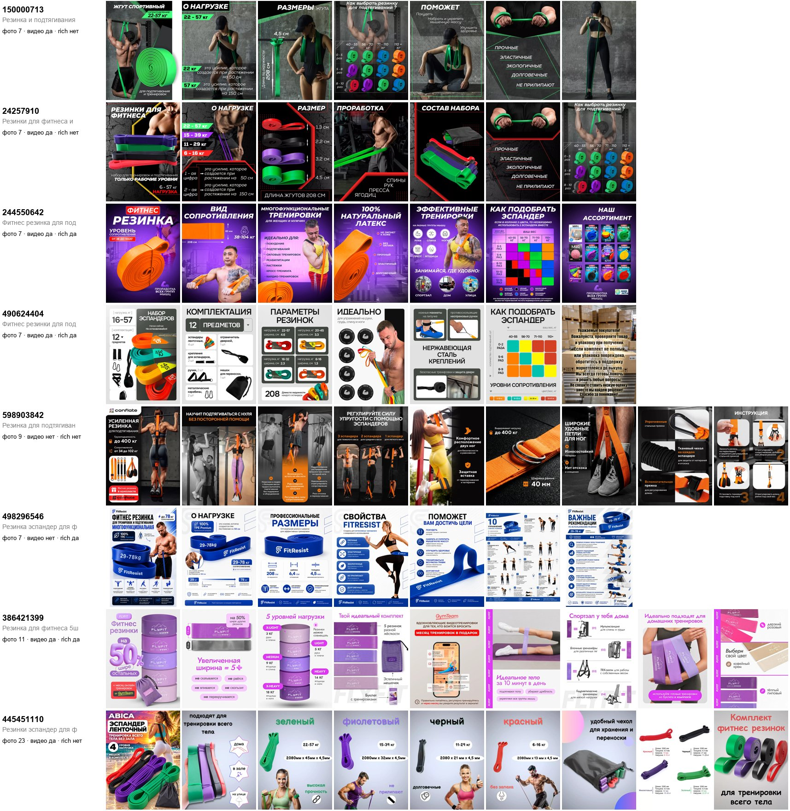
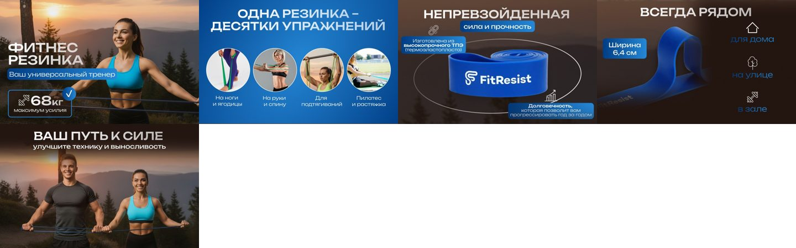
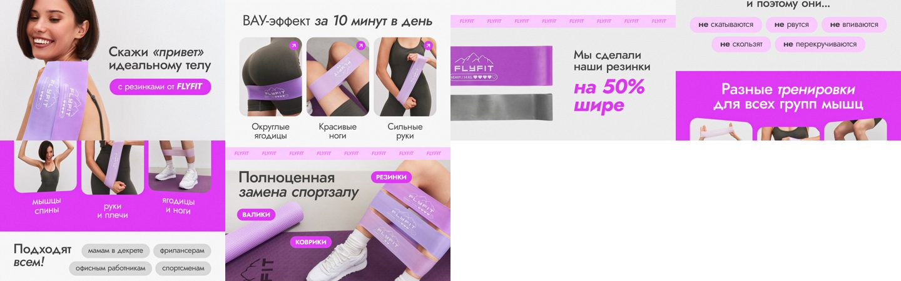
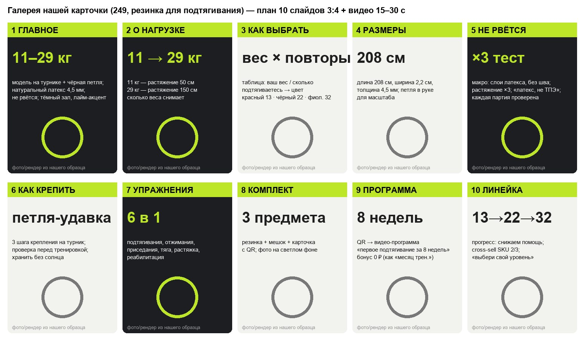
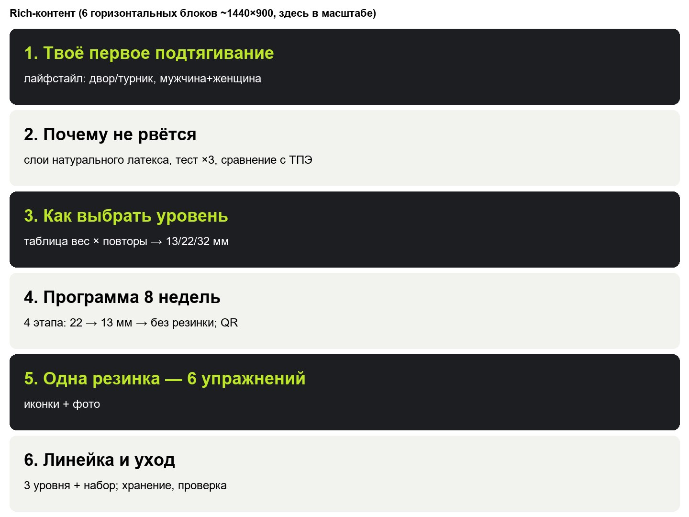

# 249 ձգման ժապավեն. մրցակիցների քարտերի վերլուծություն (լուսանկարներ, բնութագրեր, rich content) և մեր քարտի պլանը (2026-10-18)

## Աղբյուրներ

- **WB CDN, 11 քարտ, 2026-10-18** [факт]. ներառված են `card.json`-ը, պատկերասրահները (`images/big`) և `rich.json`-ը։
- **Saleflow `by_period`, 2026-05-01 … 2026-07-31** [факт]. վաճառքի և գովազդի տվյալներ։
- **Ամփոփ նկարներ**՝
  - `reports/assets/card249_competitor_galleries.jpg`
  - `card249_rich_*.jpg`
  - `card249_gallery_plan.jpg`
  - `card249_rich_plan.jpg`

## 1. Ինչ կա մրցակիցների քարտերում

| SKU | Ձևաչափ | Վաճառք/օր | Գին ₽ | Լուսանկար | Վիդեո | Rich | Բնութագրեր | Նկարագրություն, նիշ |
|---|---|---:|---:|---:|---|---|---:|---:|
| 150000713 | 1 ժապավեն 45 մմ | **114** | 470 | 7 | այո | ոչ | 7 | 771 |
| 24257910 | 4 ժապավենի հավաքածու | **115** | 940 | 7 | այո | ոչ | 7 | 1 558 |
| 598903842 | համակարգ ոտքի օղակով | 14,3 | 1 363 | 9 | ոչ | ոչ | 6 | 1 325 |
| 244550642 | 1 ժապավեն 64 մմ | 12,7 | 656 | 7 | այո | այո | **4** | 1 947 |
| 583381042 | 598903842-ի կրկնօրինակը | 10,0 | 1 386 | 9 | — | — | 6 | 1 325 (նույն տեքստը) |
| 490624404 | 12 առարկայի հավաքածու | — | — | 7 | այո | այո | **3** | 1 793 |
| 498296546 | 1 ժապավեն, ТПЭ | — | — | 7 | ոչ | այո (5 բլոկ) | 8 | 1 467 |
| 386421399 | 5 մինի-ժապավեն | — | — | 11 | այո | այո (6) | 9 | 1 045 |
| 445451110 | 4 ժապավեն | — | — | **23** | այո | ոչ | 5 | 1 999 |

- Վաճառքը և գինը՝ Saleflow 2026-05 … 07 [факт]։
- «—» նշանակում է, որ `by_period`-ը այս SKU-ի համար չենք քաշել։

### Գլխավոր դիտարկումներ [факт → եզրակացություն]

1. **Լիդերները հաղթում են ոչ թե քարտով։**
   - 2 լիդերը (≈ 115 հատ/օր յուրաքանչյուրը) ունեն 7 լուսանկար, rich content չունեն, լրացված է 7 բնութագիր, նկարագրությունը 771–1 558 նիշ է։
   - Նրանց իրական շարժիչը գովազդն է (92–97 % օրերի) և 26–29 հազ. կարծիքը։
   - Մեզ համար քարտը **CTR-ի և փոխարկման** գործիք է, ոչ թե առաջխաղացման փոխարինող։
2. **Լիդերների տեսողական կոդը նույնն է.**
   - մութ «գրանժ» մարզասրահ
   - մոդելը турник-ի վրա
   - դեղին/կանաչ բլոկ-վերնագրեր
   - **մեծ թիվ կգ-ով**
3. **Սլայդների ստանդարտ հաջորդականություն** (150000713 ≈ 24257910, նույն դիզայներական ձեռագիրը).

   | № | Սլայդ | Ինչ կա |
   |---|---|---|
   | 1 | Գլխավոր | «22–57 кг» |
   | 2 | «О нагрузке» | 22 կգ = ձգում 50 սմ, 57 կգ = 150 սմ |
   | 3 | «Размеры» | 208 սմ / 4,5 սմ |
   | 4 | «Как выбрать» | աղյուսակ «քաշ × կրկնություններ → գույն» |
   | 5 | «Поможет» | |
   | 6 | Հատկություններ | «прочные, эластичные, экологичные, долговечные, не прилипают» |
   | 7 | Lifestyle | |

4. **Բեռնվածության շուկայական կոնվենցիա** (24257910, 445451110) [факт]. Գույները համընկնում են մեր SKU-ների հետ.

   | Ժապավեն | Գույն | Բեռնվածություն |
   |---|---|---|
   | 13 մմ | կարմիր | **6–16 կգ** |
   | 22 մմ | սև | **11–29 կգ** |
   | 32 մմ | մանուշակագույն | **15–39 կգ** |
   | 45 մմ | կանաչ | 22–57 կգ |

5. **Ուռճացված խոստումներ.**
   - 598903842-ում և 583381042-ում գրված է «до 400 кг», 244550642-ում՝ «38–104 кг»։
   - Կարծիքներում «не соответствует нагрузке» բողոքը 8,6 % է (նախկին վերլուծություն)։
6. **Rich content-ն օգտագործում են միջին և նոր քարտերը, ոչ լիդերները։**
   - 498296546 (FitResist, 5 բլոկ). «Ваш универсальный тренер» → «Одна резинка — десятки упражнений» → «Непревзойдённая прочность (ТПЭ)» → «Всегда рядом: дом/улица/зал» → «Ваш путь к силе»։
   - 386421399 (FLYFIT, 6 բլոկ, նոր հաղթող)՝ emotional կին մոդել → «ВАУ-эффект за 10 минут» → «**на 50 % шире**» → «не скатываются / не рвутся / не впиваются» → «для всех групп мышц» → «подходят всем»։
   - Rich-ի օրինաչափությունը՝ **հորիզոնական բլոկներ, 1 միտք = 1 բլոկ, մեծ վերնագիր + 3–4 նկար/պատկերակ**։
7. **Բնութագրերը թերի են լրացված բոլորի մոտ։**

   | Բնութագիր | Քարտեր (11-ից) |
   |---|---:|
   | Цвет, Комплектация, Страна | 11 |
   | Материал | 10 |
   | Нагрузка максимальная | 9 |
   | Количество в упаковке | 7 |
   | Ширина | 5 |
   | Толщина | 3 |
   | **Длина** | **1** |

   - Լիդերները նյութը նշում են որպես «резина», ոչ թե «натуральный латекс»։
   - Սա բաց է. WB-ի ֆիլտրերը և որոնումը աշխատում են բնութագրերով։
8. **Գնային վտանգ** [факт]. Գնորդը որոնման մեջ տեսնում է.
   - լիդերի 1 ժապավենը 470 ₽-ով
   - 4 ժապավենի հավաքածուն 940 ₽-ով
   - մեր 1 ժապավենը 1 168 ₽-ով

   Եզրակացություն.
   - Քարտը **պետք է արդարացնի գինը** ավելի ուժեղ, քան մրցակիցներինը. ապացուցված ամրություն, ծրագիր, խնամք, կոմպլեկտ։
   - Իրատեսական սպասումը, ինչպես արդեն գրել ենք, **3–5 հատ/օր** է (deep249_addendum, ենթահատված 800–1 100 ₽)։

### Rich content-ի օրինակներ

## 2. Մեր դիրքավորումը (մեկ նախադասությամբ)

> **«Резинка, которая не рвётся, и программа, которая доводит до первого подтягивания».**

Այս նախադասությունը ծածկում է №1 բողոքը («порвалась», 13,1 %)։ Այն նաև տալիս է գնորդին արդյունք (առաջին ձգումը), ոչ թե պարզապես ռետին։

## 3. Մեր պատկերասրահը. 10 սլայդ (3:4) + վիդեո

| № | Սլայդ | Վերնագիր (ռուս.) | Բովանդակություն | Ում դեմ / ինչու |
|---|---|---|---|---|
| 1 | Գլխավոր | **11–29 кг** · натуральный латекс 4,5 мм · не рвётся | մոդելը турник-ի վրա + սև օղակ, մութ ֆոն, **լայմ** ակցենտ (լիդերները՝ կանաչ/դեղին) | CTR. թիվը կարդացվում է 1 վայրկյանում |
| 2 | Բեռնվածություն | О нагрузке | 11 կգ = ձգում 50 սմ, 29 կգ = 150 սմ, «сколько веса снимает» | ազնիվ թվեր ↔ «до 400 кг» |
| 3 | Ընտրություն | Как выбрать уровень | աղյուսակ «ваш вес × сколько подтягиваетесь → цвет» | ստանդարտ է 2 լիդերի մոտ, առանց դրա՝ վերադարձներ |
| 4 | Չափեր | Размеры | 208 / 2,2 / 0,45 սմ, ժապավենը ձեռքում՝ մասշտաբի համար | |
| 5 | Ամրություն | Не рвётся: тест ×3 | լատեքսի շերտերի մակրո, ձգում ×3, «латекс, не ТПЭ», «каждая партия проверена» | №1 բողոքը (13,1 %) |
| 6 | Ամրացում | Как крепить на турник | 3 քայլ (петля-удавка), ստուգում մարզումից առաջ, պահել առանց արևի | պատռվելու մեծ մասը սխալ ամրացումից է [допущение] |
| 7 | Վարժություններ | 6 упражнений | ձգումներ, push-up, squat, тяга, растяжка, реабилитация | |
| 8 | Կոմպլեկտ | В комплекте | ժապավեն + պայուսակ + QR քարտ, լուսավոր ֆոն | |
| 9 | Ծրագիր | Программа «первое подтягивание за 8 недель» | QR → վիդեո | 386421399-ի «месяц тренировок в подарок»-ի անալոգը, 0 ₽ |
| 10 | Գիծ | Выбери свой уровень 13 → 22 → 32 | առաջընթաց, cross-sell SKU 2/3 | |
| Վիդեո | 15–30 վ | | ձգում ժապավենով + ×3 ձգման թեստ | լիդերները բոլորը վիդեո ունեն |

Սլայդները մրցակիցների օգնությամբ համեմատելիս. 2 լիդերի 7 սլայդից մենք պահում ենք 5-ը (1, 2, 3, 4, 7) և ավելացնում ենք 5 տարբերակող սլայդ (5, 6, 8, 9, 10)։

## 4. Rich content. 6 բլոկ

| № | Բլոկ | Բովանդակություն |
|---|---|---|
| 1 | Твоё первое подтягивание | lifestyle. բակային турник, տղամարդ + կին (FitResist-ի և FLYFIT-ի emotional բացումը) |
| 2 | Почему не рвётся | լատեքսի շերտեր, ×3 թեստ, համեմատություն ТПЭ-ի հետ (առանց մրցակցի անվան) |
| 3 | Как выбрать уровень | աղյուսակ վաճառողի քաշ × կրկնություններ → 13/22/32 մմ |
| 4 | Программа 8 недель | 4 փուլ. 22 մմ → 13 մմ → առանց ժապավենի; QR |
| 5 | Одна резинка — 6 упражнений | պատկերակներ + լուսանկարներ (FitResist-ի «десятки упражнений») |
| 6 | Линейка и уход | 3 մակարդակ + հավաքածու; պահպանում, ստուգում |

Rich-ը ոչ թե «պետք» է (լիդերները չունեն), այլ **էժան առավելություն** է ցածր գնային հատվածից տարբերվելու համար։

## 5. Բնութագրեր (լրացնել բոլորը, լիդերների 7-ի փոխարեն)

| Բնութագիր | SKU 1 | SKU 2 (զույգ) | SKU 3 |
|---|---|---|---|
| Предмет | Эспандеры | Эспандеры | Эспандеры |
| Вид эспандера | ленточный (петля) | ленточный (петля), набор | ленточный (петля) |
| Материал изделия | натуральный латекс | натуральный латекс | натуральный латекс |
| Нагрузка максимальная | 29 кг | 29 кг | 39 кг |
| Нагрузка (в описании и на слайде) | 11–29 кг | 6–16 + 11–29 кг | 15–39 кг |
| Длина предмета | 208 см | 208 см | 208 см |
| Ширина предмета | 2,2 см | 1,3; 2,2 см | 3,2 см |
| Толщина предмета (мм) | 4,5 мм | 4,5 мм | 4,5 мм |
| Цвет | черный | красный; черный | фиолетовый |
| Количество в упаковке | 1 шт. | 2 шт. | 1 шт. |
| Комплектация | резинка — 1 шт.; мешок для хранения — 1 шт.; карточка с программой — 1 шт. | резинки — 2 шт.; мешок; карточка | резинка; мешок; карточка |
| Назначение | подтягивания; фитнес; растяжка; кроссфит; реабилитация; домашние тренировки | то же | то же |
| Пол | унисекс | унисекс | унисекс |
| Страна производства | Китай | Китай | Китай |
| Вес с упаковкой | ≈ 230 г [допущение] | ≈ 350 г [допущение] | ≈ 330 г [допущение] |
| Размер упаковки | 20 × 15 × 4 см [допущение] | 22 × 16 × 5 см [допущение] | 20 × 15 × 5 см [допущение] |

**SKU 3-ի ուղղում.**
- Մատակարարի աղյուսակով 32 մմ = 95 lb ≈ 43 կգ [факт, 1688]։
- Շուկայական կոնվենցիան **15–39 կգ** է [факт, 24257910, 445451110]։
- Գրում ենք **39 կգ**, որպեսզի չստանանք «не соответствует нагрузке» բողոքներ։
- SKU 1-ը (29 կգ) և SKU 2-ի կարմիրը (16 կգ) համընկնում են և՛ մատակարարի, և՛ շուկայի տվյալների հետ։

## 6. Վերնագիր և նկարագրություն

**Վերնագիր** (41 նիշ). `Резинка для подтягивания на турник 29 кг`

**Նկարագրություն** (≈ 1 500 նիշ). Լիդերներինը 771–1 999 նիշ է։ Կառուցվածքը.
1. Ինչ է և ում համար. բանալի բառեր՝ резинка для подтягивания, на турник, резинка для фитнеса, эспандер ленточный.
2. Բեռնվածությունը կոնվենցիայով (11 կգ 50 սմ-ում, 29 կգ 150 սմ-ում) + չափեր։
3. Ինչու չի պատռվում. բնական շերտավոր լատեքս, առանց կարի, թեստ ×3։
4. Ինչպես ընտրել (30–40 % քաշի օգնություն; 8 կրկնությունից հետո՝ իջնել մակարդակով)։
5. Կոմպլեկտ + QR ծրագիր։
6. Խնամք և անվտանգություն։

Բազային տեքստը արդեն կա `product_spec_249_2026-10-18.md`-ում։ Ավելացնել պետք է 2-րդ և 6-րդ կետերը։

## 7. Ինչ չանել

| Չանել | Ինչու |
|---|---|
| «до 400 кг», «до 104 кг» | «не соответствует нагрузке» բողոքներ (8,6 %) |
| Նյութը գրել «резина» | կորցնում ենք «натуральный латекс» ֆիլտրը և փաստարկը |
| Մատակարարի լուսանկարները գլխավորում | բոլոր հաղթողները ունեն սեփական նկարահանում + ինֆոգրաֆիկա |
| Կրկնօրինակ քարտեր նույն տեքստով (598903842 / 583381042 օրինակով) | 3 SKU-ն՝ **1 սոսնձված քարտում** (հաղթողների մեդիանը) |
| 1 սլայդում 3+ միտք | մոբայլում չի կարդացվում |

## 8. Լրացուցիչ SKU (3–6 ամսում). «3 մակարդակի հավաքածու»

| Տարբերակ | Գին ₽ | Մարժա | ROI | Զուտ/հատ ₽ |
|---|---:|---:|---:|---:|
| Հավաքածու 13 + 22 + 32 մմ + պայուսակ (0,62 կգ, ¥ 12,25) | 1 432 | 13,6 % ❌ | 53 % | 194 |
| նույնը | 1 590 | 17,1 % ❌ | 74 % | 272 |
| նույնը | **1 790** | **20,7 % ✅** | 101 % | 371 |
| նույնը | 1 990 | 23,6 % ✅ | 128 % | 469 |

- Հաշվարկը [оценка] է՝ `scheme_am_fbs`, комиссия 21 %, выкуп 82 %, ДРР 15 %։
- Շեմերը՝ 18 % մարժա / 60 % ROI։
- Հավաքածուն պատասխանում է «4 ժապավեն 940 ₽» մրցակցին **միայն ≥ 1 790 ₽ գնով**, ուստի մեկնարկին չենք դնում։

## Հաջորդ քայլը

RFQ-ում ավելացնել 2 պահանջ.
- ժապավենի վրա տպել «11–29 кг» / «15–39 кг» (ոչ թե «до 43 кг»);
- ուղարկել ×3 ձգման թեստի վիդեոն։

Վիդեոն պետք է 5-րդ սլայդի և rich-ի 2-րդ բլոկի համար։ Չինարեն RFQ-ն կպատրաստեմ, ուղարկելու եք դուք։
