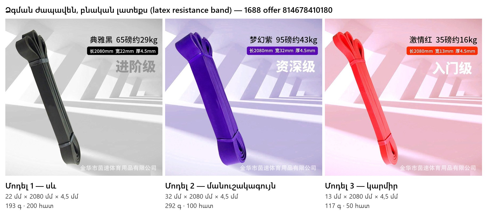

> ⚠️ Թարմացում 2026-10-22. նյութը՝ **TPE (առանց լատեքսի)**; տուփեր՝ սև 16×16×3, մանուշակագույն և զույգ 16×15×4 սմ (≤ 1 լ); քանակ 350։

# Ապրանքի բնութագիր փոխադրողի համար

| Դաշտ | Արժեք |
|---|---|
| Ապրանքի անվանում | Ձգման ժապավեն (ֆիթնես ռետին) |
| Անվանումը անգլերեն | TPE resistance band (pull-up assist band), latex-free |
| Անվանումը չինարեն | 乳胶阻力带 |
| Անվանումը ռուսերեն | Эспандер ленточный (резинка для подтягивания) |
| Ծածկագիր (ТН ВЭД / HS) | 9506 91 |
| Նյութ | TPE (թերմոպլաստիկ էլաստոմեր), առանց լատեքսի և հոտի |
| Արտադրող երկիր | Չինաստան |
| Մատակարար | 金华市茵速体育用品有限公司 (Jinhua), 1688 offer 814678410180 |
| Մարտկոց | չկա |
| Մագնիս | չկա |
| Հեղուկ | չկա |
| Փխրուն | ոչ |
| Վտանգավոր բեռ | ոչ |
| Ապրանքանիշ | առանց ապրանքանիշի |

## Մոդելներ և քանակ

| Մոդել | Գույն | Երկարություն | Լայնություն | Հաստություն | Ապրանքի քաշը | Քաշը փաթեթով | Փաթեթի չափը | Քանակ |
|---|---|---:|---:|---:|---:|---:|---|---:|
| 1 | սև | 2080 մմ | 22 մմ | 4,5 մմ | 193 գ | 228 գ | 16 × 16 × 3 սմ | 200 հատ |
| 2 | մանուշակագույն | 2080 մմ | 32 մմ | 4,5 մմ | 292 գ | 327 գ | 16 × 15 × 4 սմ | 100 հատ |
| 3 | կարմիր | 2080 մմ | 13 մմ | 4,5 մմ | 117 գ | 152 գ | 16 × 15 × 4 սմ (զույգ 13+22) | 50 հատ |

## Փաթեթավորում

| Դաշտ | Արժեք |
|---|---|
| Անհատական փաթեթ | zip-պոլիէթիլենային տոպրակ + կտորե պայուսակ + թղթե ներդիր |
| Զույգ փաթեթ | 50 հավաքածու. 1 կարմիր + 1 սև մեկ կտորե պայուսակում |
| Պիտակ | ռուսերեն, շտրիխ-կոդով, յուրաքանչյուր հատի վրա |
| Արտաքին տուփ | ծալքավոր ստվարաթուղթ, 5 շերտ |

## Ընդհանուր բեռը (մոտավոր)

| Դաշտ | Արժեք |
|---|---|
| Ընդհանուր քանակ | 350 հատ |
| Ընդհանուր քաշը | ≈ 86 կգ (տուփերով ≈ 89 կգ) |
| Ընդհանուր ծավալը | ≈ 0,45 մ³ |
| Երթուղի | Չինաստան → Մոսկվա (Подмосковье, ФФ) |
