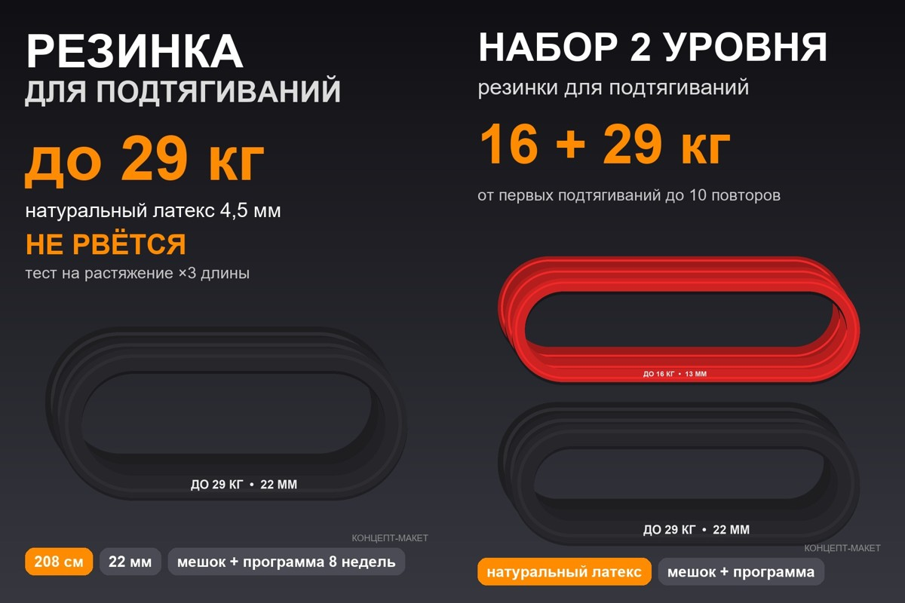

# Մեր ապրանքը. լատեքսային ձգման ժապավեն (249 «Эспандеры») — նկար և մանրամասն բնութագիր (2026-10-18)

## 1. Նկար (կոնցեպտ-մակետ)

- `reports/assets/concept_249_sku1_main.jpg`՝ SKU 1, գլխավոր լուսանկարի կոնցեպտ (900×1200, 3:4)։
- `reports/assets/concept_249_sku2_pair.jpg`՝ SKU 2, «2 մակարդակ» զույգ։
- Սա **մակետ** է՝ գույների, տեքստերի և դասավորության համար։ Վերջնական լուսանկարները պետք է լինեն **մեր նմուշի** նկարահանումից (կամ photo-editor-ով մեր նմուշի լուսանկարից)։
- **Մատակարարի լուսանկարները** (հղում, ոչ թե հրապարակելու համար)՝ `data/raw/supplier_images/814678410180/` (offer 814678410180, 1688)։

## 2. SKU-ներ

| SKU | Գույն | Լայնություն | Հաստություն | Երկարություն | Բեռնվածություն (մատակարարի աղյուսակ) | Քաշ (մատակարար) | ¥ (1688) | Վաճառողի գին ₽ | Մարժա ДРР15 |
|---|---|---:|---:|---:|---|---:|---:|---:|---:|
| **1** | սև | 22 մմ | 4,5 մմ | 2 080 մմ | 65 lb ≈ **մինչև 29 կգ** | 193 գ | 3,8 | 1 168–1 290 | 22,6–25 % |
| **2** (զույգ) | կարմիր + սև | 13 + 22 մմ | 4,5 մմ | 2 080 մմ | 35 lb ≈ 16 կգ + 65 lb ≈ 29 կգ | 117 + 193 գ | 2,5 + 3,8 | 1 432 | 23,6 % |
| **3** | մանուշակագույն | 32 մմ | 4,5 մմ | 2 080 մմ | 95 lb ≈ **մինչև 43 կգ** | 292 գ | 5,95 | 1 432 | 24,1 % |

Աղբյուրներ.
- Բեռնվածությունը, չափերը և քաշը՝ [факт, մատակարարի աղյուսակը լուսանկարում և «商品件重尺», offer 814678410180]։
- ¥-ը՝ [факт, 1688, 2026-10-18]։
- Մարժան՝ [оценка, `scheme_am_fbs`, комиссия FBS 21 % [факт, WB API], выкуп 82 %]։

Բեռնվածությունը գրում ենք **«до N кг»**, ինչպես մատակարարի աղյուսակում։ «До 400 кг» տիպի ուռճացված թվերը բերում են «не соответствует нагрузке» բողոքներ (8,6 %)։

## 3. Պահանջներ մատակարարին (RFQ)

| Կետ | Պահանջ |
|---|---|
| Նյութ | **100 % բնական լատեքս** (ոչ TPE), շերտավոր (layered), առանց կարի, առանց տալկի ավելցուկի |
| Հաստություն | 4,5 մմ ± 0,2 |
| Երկարություն | 2 080 մմ (փակ օղակ) |
| Տպագրություն ժապավենի վրա | լոգո + «до 29 кг / 22 мм» (ռուսերեն), սպիտակ գույնով, չի մաշվում |
| Ամրության թեստ | ձգում մինչև 3× երկարություն, 10 000 ցիկլ; թեստի լուսանկար/վիդեո |
| Հոտ | նվազագույն (ազատ օդափոխության 48 ժամ մինչև փաթեթավորումը) |
| Փաթեթավորում | անհատական zip-պոլիէթիլեն + կտորե պայուսակ (drawstring, 20×25 սմ, լոգոյով) + տպագիր ներդիր QR-ով |
| Ներդիր | 9×13 սմ, ռուսերեն. «как выбрать уровень», 5 վարժություն, QR → «программа подтягиваний 8 недель» |
| Փաստացի քաշը փաթեթով | պարտադիր նշել (մատակարարի տվյալը կասկածելի է՝ 45 գ vs 193 գ) |
| MOQ / նմուշ | 300 հատ (200 × 22 մմ + 100 × 32 մմ) + 2 նմուշ յուրաքանչյուր լայնությունից |
| Մակնշում | «Сделано в Китае», կազմ, չափ, բեռնվածություն (WB-ի պահանջով՝ ռուսերեն պիտակ) |

## 4. WB քարտ

**Վերնագիր** (≤ 60 նիշ, WB-ի խորհուրդը՝ ≤ 40). `Резинка для подтягивания на турник 29 кг` (41 նիշ)

| Բնութագիր | SKU 1 | SKU 2 | SKU 3 |
|---|---|---|---|
| Предмет | Эспандеры | Эспандеры | Эспандеры |
| Вид эспандера | ленточный (петля) | ленточный (петля), набор | ленточный (петля) |
| Материал изделия | натуральный латекс | натуральный латекс | натуральный латекс |
| Нагрузка максимальная | 29 кг | 16 кг; 29 кг | 43 кг |
| Длина предмета | 208 см | 208 см | 208 см |
| Ширина предмета | 2,2 см | 1,3 см; 2,2 см | 3,2 см |
| Толщина | 4,5 мм | 4,5 мм | 4,5 мм |
| Цвет | черный | красный; черный | фиолетовый |
| Количество предметов в упаковке | 1 шт. | 2 шт. | 1 шт. |
| Комплектация | резинка — 1 шт.; мешок для хранения — 1 шт.; карточка с программой тренировок — 1 шт. | резинки — 2 шт.; мешок; карточка | резинка — 1 шт.; мешок; карточка |
| Назначение | подтягивания на турнике; фитнес; растяжка; кроссфит; домашние тренировки; реабилитация | то же | то же |
| Пол | унисекс | унисекс | унисекс |
| Страна производства | Китай | Китай | Китай |
| Вес товара с упаковкой (г) | ≈ 230 [допущение: 193 + пайուսակ 30 + ներդիր 5] | ≈ 350 | ≈ 330 |
| Длина / ширина / высота упаковки | 20 / 15 / 4 см [допущение] | 22 / 16 / 5 см | 20 / 15 / 5 см |

**Նկարագրություն** (≈ 900 նիշ, ռուսերեն).

> Резинка для подтягивания на турник из натурального латекса — помогает сделать первые подтягивания и увеличить количество повторов. Петля длиной 208 см, ширина 2,2 см, толщина 4,5 мм, нагрузка до 29 кг. Многослойный латекс без швов не рвётся при правильном использовании: каждую партию проверяем растяжением в 3 раза. Подходит для подтягиваний и отжиманий с поддержкой, растяжки, кроссфита, тренировок дома, на улице и в зале. Как выбрать: если вы не подтягиваетесь ни разу — берите резинку, которая снимает 30–40 % вашего веса; когда получится 8 повторов — переходите на уровень ниже. В комплекте мешок для хранения и карточка с QR-кодом — программа подтягиваний на 8 недель с видео. Храните вдали от солнца и острых предметов, перед тренировкой проверяйте целостность резинки.

**Բանալի բառեր** (2026-06-ի հաճախականությամբ, Saleflow) [факт].

| Բառ | Հաճախականություն | Որտեղ դնել |
|---|---:|---|
| резинка для фитнеса | 83 350 | բնութագրեր, նկարագրություն |
| эспандер | 66 635 | բնութագրեր |
| резинка для подтягивания | 18 857 | **վերնագիր** |
| резинка для подтягивания на турник | 12 993 | **վերնագիր** |
| резина для тренировок | 10 882 | նկարագրություն |
| жгут | 10 542 | նկարագրություն |
| эспандер ленточный, лента | — / 22 013 | նկարագրություն |

## 5. Ինֆոգրաֆիկայի սլայդներ (photo-editor, նմուշից հետո)

| Սլայդ | Բովանդակություն |
|---|---|
| 1 | Գլխավոր. ժապավենը օղակով + մարդը турник-ի վրա, «до 29 кг», «не рвётся · натуральный латекс» (տես մակետը) |
| 2 | «Как выбрать уровень». աղյուսակ «ваш вес → цвет» (13 / 22 / 32 մմ) |
| 3 | «Тест на разрыв». ձգում ×3 երկարությամբ, լատեքսի շերտերը խոշոր պլանով |
| 4 | 5 վարժություն (ձգումներ, push-up, ծնկատակներ, deadlift, ձգվողականություն) |
| 5 | Կոմպլեկտ. ժապավեն + պայուսակ + QR ծրագիր |
| 6 | Առաջընթաց. «13 → 22 → 32 мм» (cross-sell դեպի SKU 2/3) |

Հաջորդ քայլը: ուղարկել RFQ-ն (բաժին 3) 1688-ի 3 մատակարարին. չինարեն տեքստը կպատրաստեմ, ուղարկելու եք դուք։
